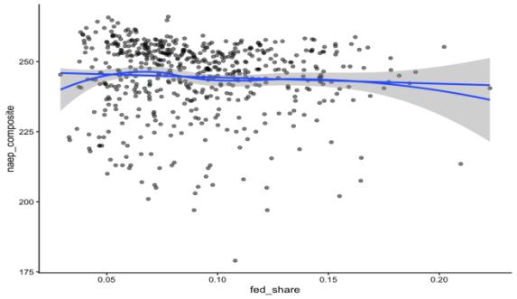
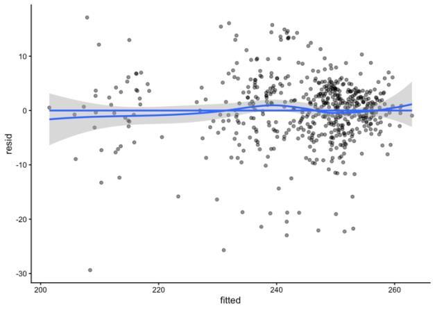

# State Education Finance and Student Achievement

**Does instructional spending per pupil, or reliance on federal revenue, explain differences in states' NAEP scores?**
*MSSP 8970 Applied Linear Modeling · University of Pennsylvania · Fall 2025 · co-authored with Siyuan Zheng*

The study uses a state-year panel (564 observations, 1992–2015) from the public **U.S. Education Datasets: Unification Project**. Linear models are developed in sequence, and diagnostics and corrections are treated as part of the analysis rather than an afterthought.

**Stack:** R · `lm` with year fixed effects · sandwich / lmtest (HC1 robust SEs) · car (VIF) · ggplot2 · modelsummary

---

## Research questions
1. Do models of education finance and achievement meet the assumptions of the general linear model?
2. Once diagnostic issues are addressed, how do the estimated relationships of **instructional spending per pupil** and **federal revenue share** with NAEP performance change?
3. Does federal funding **moderate** the spending–achievement relationship?

## Data and variables
| Variable | Construction |
|---|---|
| `naep_composite` (outcome) | Mean of the state's NAEP grade-4 and grade-8 math and reading averages |
| `log_instr_pp` | log(instructional expenditure ÷ enrollment). Raw per-pupil spending is strongly right-skewed. |
| `fed_share` | Federal revenue ÷ total education revenue |
| Year fixed effects | `factor(year)`, to absorb national trends in NAEP scores |

## Results
| Model | log instructional $ per pupil | Federal revenue share | Interaction | N | Adj. R² | AIC |
|---|---|---|---|---|---|---|
| 1 · Base (year FE) | 0.90 (n.s.) | **−133.0\*\*\*** | | 564 | 0.773 | 3689.5 |
| 2 · Corrected (influential obs. removed) | 1.00 (n.s.) | **−154.3\*\*\*** | | 522 | 0.872 | 3027.9 |
| 3 · Interaction | −2.42 | **−219.7\*\*\*** | **+41.1\*\*** (p = .016) | 522 | 0.873 | 3023.9 |

**Findings**
- **Funding composition matters more than funding level.** In bivariate terms spending is strongly correlated with NAEP (r = 0.65), but this vanishes once year effects are controlled for.
- **Federal revenue share is strongly and negatively associated with achievement.** Each extra percentage point of federal share goes with about 1.5 fewer NAEP points. Federal aid is targeted at high-need states, so this is read as a marker of **structural disadvantage**, not as harm from federal funding.
- **Spending is more strongly linked to achievement in states that rely more on federal funding.** This is the positive interaction, confirmed by a nested F-test and a lower AIC. Federal support may complement state instructional investment.

**Diagnostics.** LOESS-vs-linear plots support linearity. Residual-vs-fitted plots show mild heteroskedasticity, which is handled with HC1 robust SEs. Residuals are near-normal, with an irregular upper tail. Cook's distance, leverage and studentized residuals flag 42 influential state-years, mostly the District of Columbia. Removing them is the single largest improvement in fit (AIC 3689 → 3028). VIF is checked for multicollinearity, and the predictors are only weakly correlated (r = −0.08).

<p float="left">
  
  
</p>

**Limitations.** The data is observational and aggregated to the state level, and it has no poverty or demographic controls. The results are associations, not causal effects.

## Repository
```
├── analysis.Rmd     # full analysis: preparation → descriptives → base model → diagnostics → corrected & interaction models
├── figures/         # figures from the final report
└── data/            # place states_all.csv here
```

## Reproduce
1. Download `states_all.csv` from the [U.S. Education Datasets: Unification Project](https://www.kaggle.com/datasets/noriuk/us-education-datasets-unification-project) (Kaggle) into `data/`.
2. In R, install the packages: `dplyr`, `tidyr`, `readr`, `janitor`, `ggplot2`, `lmtest`, `sandwich`, `car`, `modelsummary`, `knitr`.
3. From the repository folder, run: `Rscript -e "knitr::knit('analysis.Rmd')"`
